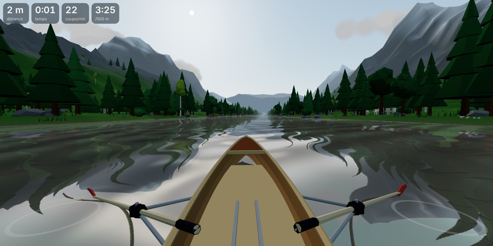
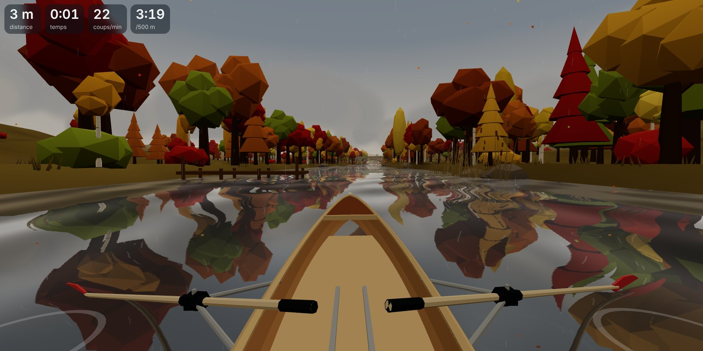
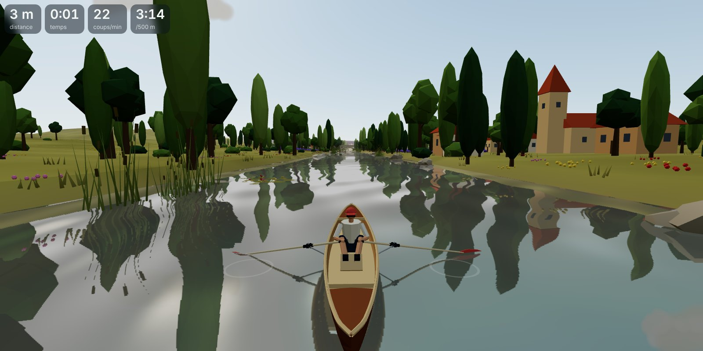
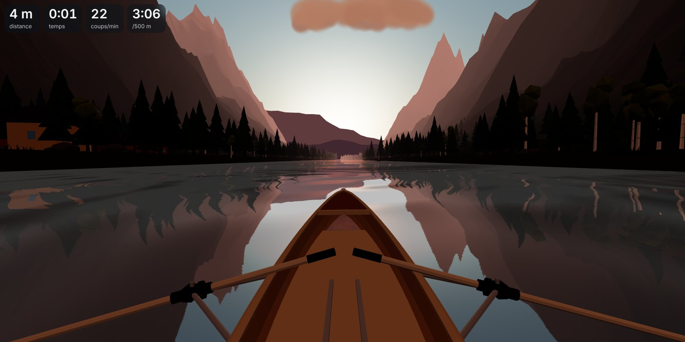
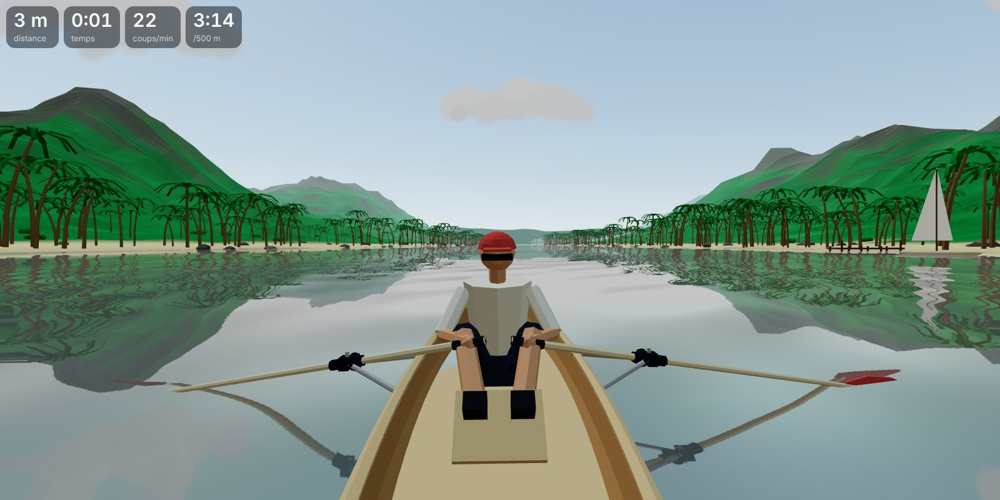
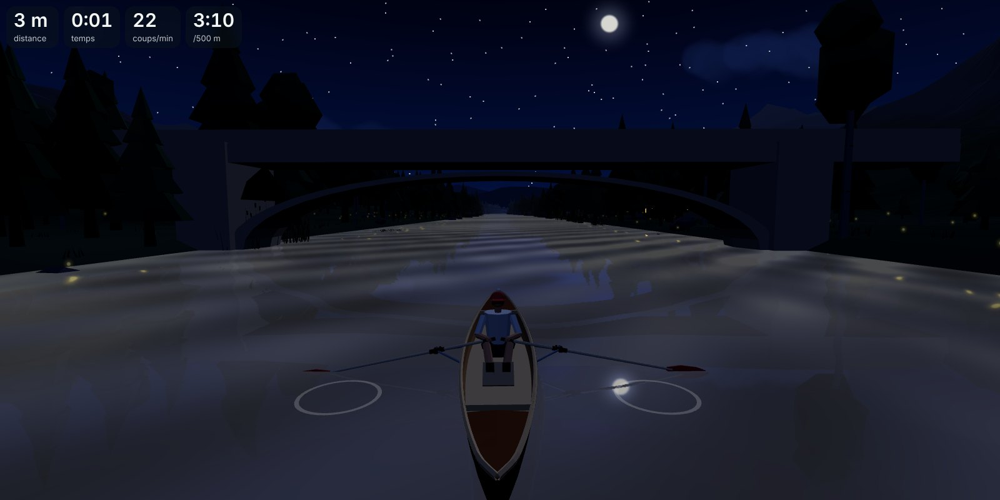
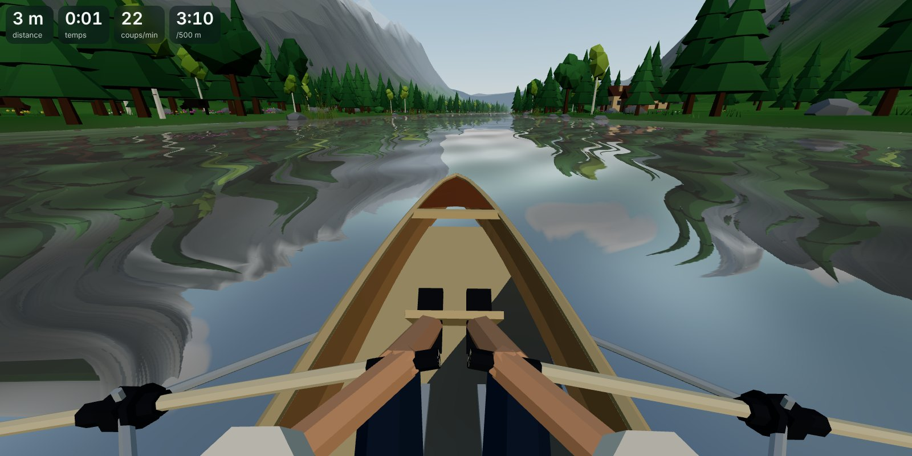

<h1 align="center">🚣 Balade à la rame</h1>

<p align="center">
  <b>Ton rameur d'appartement devient une yole.</b><br>
  Connecte-le en Bluetooth, rame, et glisse sur un lac alpin, une rivière d'automne ou un fjord au crépuscule.<br>
  Tout tourne dans le navigateur : pas de compte, pas d'installation, pas d'abonnement.
</p>

<p align="center">
  
</p>

<p align="center">
  <a href="#-essayer-en-30-secondes">Essayer</a> ·
  <a href="#-six-décors">Décors</a> ·
  <a href="#-quatre-points-de-vue">Vues</a> ·
  <a href="#-déployer">Déployer</a> ·
  <a href="#-sous-le-capot">Sous le capot</a>
</p>

---

## ✨ Pourquoi c'est chouette

- **La yole avance à ton rythme.** Chaque coup d'aviron à l'écran est calé sur le tien : attaque, propulsion, dégagé, retour.
- **Six décors qui défilent sans fin**, générés à la volée : forêts, villages, ponts, roselières, canards, poissons qui sautent, vols d'oiseaux.
- **Une ambiance sonore entièrement synthétisée** : clapotis, avirons dans l'eau, oiseaux, cigales, pluie fine, cloches. Aucun fichier audio.
- **Zéro dépendance externe.** Un fichier HTML, Three.js embarqué, une image Docker de quelques Mo. Rien ne sort de chez toi.
- **Pas de rameur sous la main ?** Le mode démo règle la cadence au curseur.

## 🏞 Six décors

En mode **Balade**, le décor change tout seul tous les 1,5 km. Tu peux aussi le choisir dans le menu.

| | |
|:---:|:---:|
| <br>**Rivière d'automne** · pluie fine, feuilles qui tombent | <br>**Canal de Provence** · cyprès, lavande, cigales |
| <br>**Fjord au crépuscule** · brume, goélands, cascade | <br>**Lagon tropical** · palmiers, ressac, voiliers |
| <br>**Nuit d'été** · lucioles, grillons, chouette | <br>**Lac alpin** · sonnailles, vaches, sommets enneigés |

## 🎥 Quatre points de vue

Le bouton **Vue** fait défiler les caméras ; ton choix est mémorisé.

| Vue | Ce que tu vois |
|---|---|
| **À bord** *(par défaut)* | Vue subjective, face à la proue, les deux avirons de part et d'autre. |
| **Poursuite** | Derrière la yole, pour voir le rameur travailler. |
| **Barreur** | Assis à la poupe, face au rameur. |
| **Rameur** | Dos à la marche, comme en vrai : tes mains, tes genoux, le sillage qui s'éloigne. |

<p align="center">
  
</p>

## 📊 Ce qui s'affiche

Distance, temps, cadence (coups/min) et allure au 500 m, plus la puissance (watts), les calories et la fréquence cardiaque quand le rameur les transmet. L'écran reste allumé pendant la séance.

## 🚀 Essayer en 30 secondes

```bash
docker run -p 8080:80 ghcr.io/kolapsis/balade-rame:latest
```

Ouvre <http://localhost:8080> dans **Chrome** ou **Edge**, puis :

1. **Connecter le rameur** et choisis-le dans la liste Bluetooth — ou **Essayer sans rameur** pour le mode démo.
2. Monte le son.
3. Rame.

> [!NOTE]
> Le Bluetooth web exige **HTTPS** (sauf sur `localhost`) et un navigateur qui le gère : Chrome ou Edge sur Android, PC et Mac. Sur iPhone, Safari ne le gère pas : passe par le navigateur [Bluefy](https://apps.apple.com/app/bluefy-web-ble-browser/id1492822055).

### Rameurs compatibles

Tout rameur qui expose le service Bluetooth standard **FTMS** (Fitness Machine Service). Testé avec un **Merach R28**.

## 📦 Déployer

Le dépôt fournit un `docker-compose.yml` prêt pour Traefik :

1. Remplace `rame.example.com` par ton domaine (et `kolapsis` par ton compte si tu publies ta propre image).
2. `docker compose pull && docker compose up -d`
3. Ouvre `https://ton-domaine`, téléphone ou tablette en paysage de préférence.

Pour construire l'image toi-même :

```bash
docker build -t balade-rame . && docker run -p 8080:80 balade-rame
```

### Publication de l'image

GitHub Actions (`.github/workflows/docker.yml`) construit l'image amd64 + arm64 et la pousse sur ghcr.io :

| Événement | Tags de l'image |
|---|---|
| Release `v1.4.2` publiée | `1.4.2`, `1.4`, `1`, `latest` |
| Push sur `main` | `edge`, `sha-abc1234` |
| Pull request | build seul, rien n'est poussé |

Le numéro de version de la release s'affiche sur l'écran d'accueil. Crée la release avec un tag au format `vX.Y.Z` (ex. `gh release create v1.0.0 --generate-notes`).

## 🔧 Sous le capot

Pas de build, pas de framework, pas de `node_modules` : l'appli tient dans `index.html`.

- **3D** — [Three.js](https://threejs.org) r170 embarqué. Terrain généré par tronçons le long d'une rivière sinueuse, végétation instanciée qui ondule au vent, eau réfléchissante, ciel atmosphérique.
- **Yole et rameur** — coque lofée, avirons pivotant sur leurs dames de nage, rameur animé par cinématique inverse (jambes → dos → bras).
- **Son** — Web Audio uniquement : bruits filtrés, oscillateurs et réverbération à convolution propre à chaque lieu.
- **Rameur connecté** — Web Bluetooth, caractéristique *Rower Data* du service FTMS.
- **Écran allumé** — Screen Wake Lock, avec une vidéo muette en secours.

| Fichier | Rôle |
|---|---|
| `index.html` | L'application |
| `three.module.min.js`, `Water.js`, `Sky.js` | Three.js r170 (licence MIT) |
| `Dockerfile`, `nginx.conf` | Image nginx, en-têtes Permissions-Policy pour le Bluetooth et le maintien d'écran |
| `.github/workflows/docker.yml` | Construction et publication de l'image |
| `docs/` | Captures d'écran |

Pour développer : `python3 -m http.server` à la racine, puis <http://localhost:8000> — le mode démo suffit pour tout tester sauf le Bluetooth.
